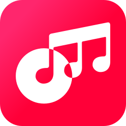

<div align="center">



# Open Music SDK for JavaScript

[](https://codecov.io/gh/open-music-sdk/js)

</div>

> Not affiliated with, endorsed by, or sponsored by Apple Inc. Apple Music and MusicKit are trademarks of Apple Inc.

An open, community-led TypeScript SDK for the Apple Music API. It gives you a typed function for nearly every
endpoint, tokens that look after themselves, and ESM-only packages for servers, web pages and React. It uses
Apple's MusicKit on the Web for one thing: signing a listener in.

> **🚧 Under construction.** Nothing is published to npm yet. The CLI's sign-in has run once against the live
> Apple Music API, on Windows; the rest hasn't, and nothing has run in a React app outside its tests. See
> [Status and roadmap](https://open-music-sdk.github.io/js/status) for what exists.

**Documentation: [open-music-sdk.github.io/js](https://open-music-sdk.github.io/js/)**

## Which package to install

Most apps install one package:

| You're building | Install |
| --- | --- |
| Server-side code: Node, Cloudflare Workers, Bun, Deno, a command-line tool | [`@open-music-sdk/server`](./integrations/server/README.md) |
| A web page without React | [`@open-music-sdk/browser`](./integrations/browser/README.md) |
| A React app | [`@open-music-sdk/react`](./integrations/react/README.md) |
| A Next.js app | `server` and `react` |

Each gives you a client with the catalog, the listener's library and playlist tools on it. See
[Which package to install](https://open-music-sdk.github.io/js/concepts/packages) for the rest of the family.

## The CLI

[`@open-music-sdk/cli`](./apps/cli/README.md) is the command you use beside the packages while you build. `doctor`
tells you whether Apple takes your MusicKit key. `login` signs you in at Apple in your browser and keeps a Music
User Token for your own account, and `token` prints it for a script to read. `check` asks the live API what the
SDK takes on trust about it.

```sh
pnpm add -D @open-music-sdk/cli
pnpm exec open-music-sdk doctor
pnpm exec open-music-sdk login
```

It reads your key from the same variables as the example below. `open-music-sdk --help` lists every command.

## Example

On your server, with your MusicKit key:

```ts
import { createServerClient } from "@open-music-sdk/server";

const music = createServerClient({
  pem: process.env.APPLE_MUSIC_PRIVATE_KEY!,
  teamId: process.env.APPLE_MUSIC_TEAM_ID!,
  keyId: process.env.APPLE_MUSIC_KEY_ID!,
  storefront: "us",
});

const album = await music.catalog.getAlbum("1613600183");
console.log(album.attributes?.name);
```

## Documentation

- [Tutorial](https://open-music-sdk.github.io/js/start/): build a page and a server that dig through Apple's
  catalog, play previews, sign you in, and send songs to your library, in about an hour.
- [Guides](https://open-music-sdk.github.io/js/guides/musickit-key): set up your key, sign a listener in, use
  Next.js or Cloudflare Workers, and more, with the code for the page and the server you pick.
- [Concepts](https://open-music-sdk.github.io/js/concepts/packages): tokens, security, errors and the design
  principles every package follows.
- [Reference](https://open-music-sdk.github.io/js/reference/): every function, type and option.
- [Sample apps](https://open-music-sdk.github.io/js/samples): one small app, written once per way of using the
  SDK, to run on your machine. The code is in [`samples/`](./samples/README.md).

## Contributing

See [CONTRIBUTING.md](./CONTRIBUTING.md) for setup, the repository layout and how to write docs.

## License

[MIT](./LICENSE) with a [Developer Certificate of Origin](./CONTRIBUTING.md#developer-certificate-of-origin) sign-off
on contributions. The project name and logo are not covered by the code license; see [TRADEMARKS.md](./TRADEMARKS.md).
Using the Apple Music API requires your own Apple Developer account and agreement with Apple.
